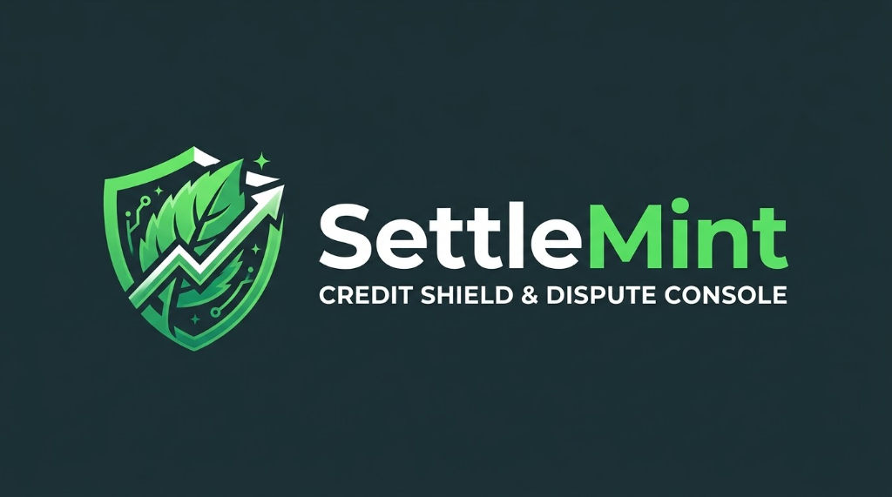

<p align="center">
  
</p>

# SettleMint: Consumer Credit Shield & Debt Collector Dispute Console

[](https://github.com/boredpolymath/settlemint/actions/workflows/ci.yml)
[](LICENSE)
[](https://www.rust-lang.org/)
[](https://tauri.app/)
[](#security--privacy-architecture)
[](#design-system-clinical-forensic-defense)

> **Prepared by Bored Polymath Studios**  
> An uncompromising, local-first forensic desktop console empowering consumers to dispute credit card debt, medical bills, auto loan deficiencies, and all consumer claims covered by the FDCPA (15 U.S.C. § 1692), enforce statutory deadlines, log collection violations, and safeguard credit profiles.

---

## Legal Disclaimer

> **PROCEDURAL SELF-ADVOCACY CONSOLE:**  
> SettleMint is a local-first recordkeeping, statutory calculation, and procedural workflow utility. It **does not provide formal legal representation or legal advice** pursuant to 15 U.S.C. § 1692. All generated dispute notices, telephone defense scripts, and violation ledgers are self-advocacy instruments intended for personal administrative dispute resolution. Consult a licensed consumer rights attorney for formal legal counsel.

---

## Table of Contents

- [Core Capabilities](#core-capabilities)
- [Supported FDCPA Debt Classifications](#supported-fdcpa-debt-classifications)
- [Design System & Responsive Architecture](#design-system--responsive-architecture)
- [Architecture Overview](#architecture-overview)
- [Security & Privacy Architecture](#security--privacy-architecture)
- [Getting Started](#getting-started)
  - [Prerequisites](#prerequisites)
  - [Installation & Local Execution](#installation--local-execution)
- [Testing & Quality Assurance](#testing--quality-assurance)
- [Community Health & Standards](#community-health--standards)
- [Contributing](#contributing)
- [License](#license)

---

## Core Capabilities

* **Multi-Debt Case Dossier Registry:** Strict containment of individual disputed debt items, binding original credit card issuers, healthcare systems, auto lenders, third-party collection agencies, debt buyers, and alleged balances.
* **30-Day FDCPA Validation Engine:** Automated enforcement of the mandatory 30-day debt validation window pursuant to 15 U.S.C. § 1692g, tracking statutory expiration dates and required collection cessations across all consumer debts.
* **Statute of Limitations (SOL) Watcher:** 50-state jurisdictional rule matrix tracking debt expiration periods across revolving credit card debt, medical debt, written promissory notes, and open accounts, actively alerting consumers against partial payment restart traps.
* **CFPB Regulation F & Chain-of-Title Audit:** Demands mandatory itemization (charge-off balance, interest, fees, credits) under 12 C.F.R. § 1006.34 and complete, unbroken chains of assignment from junk debt buyers (Midland, Portfolio Recovery, LVNV).
* **Chronological Evidentiary Stream:** Comprehensive communication ledger recording incoming and outgoing phone calls, letters, and emails with automated FDCPA violation flags (inconvenient hours, harassment, unlawful threats of lawsuit on time-barred debt under 12 C.F.R. § 1006.26).
* **Statutory Damages Accumulator:** Live ledger tabulating potential statutory damages under 15 U.S.C. § 1692k (up to $1,000 per statutory proceeding + actual damages).
* **Side-by-Side Letter Studio:** Dynamic template drafting engine with live legal document preview, Bates stamp watermarking, debt-tailored statutory demand checklists, and print-ready PDF export.
* **Mandatory Legal & Statutory Compliance System:** Prominently displays self-advocacy notices on the dashboard, in the persistent footer, and embedded directly onto generated letters to guarantee strict legal compliance.
* **Cryptographic Evidence Vault:** Local sandboxed file gallery hashing all scanned collection notices, certified mail receipts, and audio logs with SHA-256 checksums.
* **Credit Bureau Delta Auditing:** Three-bureau trade line diff tracking (Equifax, Experian, TransUnion) auditing whether collectors properly furnish dispute marks under FCRA § 623(a)(3).
* **Low-Memory System Tray Daemon:** Lightweight resident desktop service (< 25 MB RSS) delivering deadline alerts and instant quick-action intake for collector phone calls.

---

## Supported FDCPA Debt Classifications

Under 15 U.S.C. § 1692a(5), SettleMint defends any obligation arising primarily for personal, family, or household purposes:

| Debt Classification | Governing Federal & State Statutes | Key Statutory Defenses & Demands |
|---|---|---|
| **Credit Card Debt** | 15 U.S.C. § 1692g, CFPB Reg F (12 CFR Part 1006), TILA | Unbroken chain of assignment (bills of sale), $0-balance/charge-off billing history, Reg F fee itemization, cardholder agreements. |
| **Medical Debt** | 15 U.S.C. § 1692, No Surprises Act (P.L. 116-260), CPLR § 214-i | Itemized clinical accounting (CPT & ICD-10 diagnosis codes), out-of-network balance billing bans, insurance adjustment audits. |
| **Auto Loan Deficiency** | 15 U.S.C. § 1692g, UCC Article 9 (§§ 9-610, 9-611, 9-616) | Original installment sale contract, timely notice of sale, commercially reasonable auction defense, gross proceeds deficiency accounting. |
| **Personal & Installment Loans** | 15 U.S.C. § 1692g, State Consumer Credit Acts | Promissory note verification, signature validation, licensing and surety bond proof. |
| **Utility & Telecom Debt** | 15 U.S.C. § 1692g, FCRA § 623 | Service agreement verification, meter/usage accounting records, credit bureau dispute verification. |

---

## Design System & Responsive Architecture

SettleMint merges the precision of clinical laboratory baselines with judicial evidentiary procedure:

* **Fluid Adaptive Grid:** Replaced rigid columns with `repeat(auto-fill, minmax(min(100%, 330px), 1fr))`, ensuring spacious 3–4 column layouts on wide displays, comfortable 2-column viewing on laptop/split screens (900px–1250px), and clean single-column stacking on tablets/mobile.
* **Elastic Card Internals:** Long creditor titles, account numbers, and currency balances feature flex-wrapping and text-overflow protection, eliminating text clipping across all viewport sizes.
* **Visual Identity & Color Hierarchy:**
  - **Indigo (`#3730A3` / `#E0E7FF`):** Revolving credit card debts & CFPB Regulation F portfolios.
  - **Mint & Emerald (`#006948` / `#ECFDF5`):** Medical claims & No Surprises Act protections.
  - **Amber (`#92400E` / `#FEF3C7`):** Auto finance, UCC Article 9 repossession deficiencies, and statutory deadline clocks.
  - **Violet (`#6B21A8` / `#F3E8FF`):** Unsecured installment loans & fintech notes.
  - **Emergency Rose (`#E11D48` / `#FFF1F2`):** FDCPA violations, time-barred debt lawsuit threats, and statutory penalties.
* **Dynamic Inspection & Timeline:** Active dossier inspector features wrapping meta tags and touch-friendly horizontal scrolling on the 5-stage dispute progression bar.

---

## Architecture Overview

```
settlemint/
├── assets/                          # Repository & Documentation Brand Assets
│   └── settlemint-banner.png        # Official SettleMint Credit Shield banner
│
├── .github/                         # GitHub Community & CI Standards
│   ├── ISSUE_TEMPLATE/              # Structured bug, feature & statute issue forms
│   ├── workflows/ci.yml             # GitHub Actions CI workflow (Check, Clippy, Test)
│   ├── dependabot.yml               # Automated dependency vulnerability scanning
│   └── pull_request_template.md     # Standardized PR review checklist
│
├── src-tauri/                       # Native Rust Core & Tauri v2 Desktop Bridge
│   ├── Cargo.toml                   # Rust dependencies (rusqlite, chrono, uuid, sha2, tauri)
│   ├── tauri.conf.json              # Tauri v2 configuration, window bounds & CSP
│   └── src/
│       ├── main.rs                  # Native application entrypoint
│       ├── lib.rs                   # Module registration & IPC handler wiring
│       ├── db/                      # Embedded SQLite Data Layer (WAL mode, schema)
│       ├── models/                  # Core Domain Entities (DebtType, Case, Violation, etc.)
│       ├── engine/                  # FDCPA, Multi-Debt SOL, Template & Evidence engines
│       ├── commands/                # Tauri IPC Command Handlers
│       └── tray/                    # Low-Memory System Tray Daemon
│
├── ui/                              # Frontend Workspace (Clinical Forensic Defense)
│   ├── index.html                   # Desktop Workbench, Modals & Compliance Dialogs
│   ├── css/
│   │   ├── tokens.css               # Design tokens, color system, and elevation
│   │   ├── layout.css               # Responsive app layout, sidebar, and workspace viewport
│   │   └── components.css           # Adaptive dispute cards, metrics, stepper & letter preview
│   └── js/
│       ├── app.js                   # Application bootstrap, state coordination & event bus
│       ├── ipc.js                   # Tauri IPC bridge abstraction with offline fallback
│       ├── data/                    # FDCPA multi-debt seed fixtures (Credit Card, Medical, Auto, Loans)
│       └── views/                   # Modular view renderers (Dashboard, Letters, Stream, Audit, Vault)
│
├── CODE_OF_CONDUCT.md               # Contributor Covenant v2.1
├── CONTRIBUTING.md                  # Development setup, PR guidelines & code standards
├── LICENSE                          # MIT License (Bored Polymath Studios)
├── SECURITY.md                      # Security policy, threat model & disclosure process
└── README.md
```

---

## Security & Privacy Architecture

* **Zero-Telemetry Default:** Complete absence of analytics beacons, telemetry hooks, or crash-reporting webhooks.
* **At-Rest Encryption:** Local SQLite database file encrypted using AES-256 via SQLCipher with key derivation powered by Argon2id.
* **Memory Protection:** Passwords, account numbers, and Social Security Numbers are zeroized in RAM upon drop via Rust's `zeroize` crate.
* **Strict Content Security Policy (CSP):** Tauri web runtime enforces an air-tight policy prohibiting external script execution, inline eval, and unauthenticated network requests.

---

## Getting Started

### Prerequisites

* **Rust:** Stable toolchain (`rustc >= 1.90.0`, `cargo`). Install via [rustup.rs](https://rustup.rs/).
* **Tauri CLI v2:**
  ```bash
  cargo install tauri-cli --version "^2.0"
  ```
* **Platform Dependencies:**
  * **macOS:** Xcode Command Line Tools (`xcode-select --install`).
  * **Windows:** Visual Studio C++ Build Tools and Microsoft WebView2 Runtime.
  * **Linux:** `libwebkit2gtk-4.1-dev`, `build-essential`, `libssl-dev`, `libgtk-3-dev`, `libayatana-appindicator3-dev`.

### Installation & Local Execution

1. Clone the repository:
   ```bash
   git clone https://github.com/boredpolymath/settlemint.git
   cd settlemint
   ```
2. Check and verify the Rust compilation:
   ```bash
   cd src-tauri
   cargo check
   ```
3. Run the desktop application in development mode:
   ```bash
   cargo tauri dev
   ```

---

## Testing & Quality Assurance

Run the test suite and code quality linters:

```bash
# Run backend unit and integration tests
cargo test --all

# Run strict Clippy linter
cargo clippy --all-targets -- -D warnings

# Check code formatting
cargo fmt --all --check
```

---

## Community Health & Standards

SettleMint adheres strictly to GitHub community best practices:
- [Code of Conduct](CODE_OF_CONDUCT.md): Contributor Covenant v2.1.
- [Contributing Guide](CONTRIBUTING.md): Detailed development workflow, code styles, and statutory rules.
- [Security Policy](SECURITY.md): Responsible disclosure process and threat model.
- [Issue Templates](.github/ISSUE_TEMPLATE/): Structured forms for bugs, feature requests, and statutory rule updates.
- [Pull Request Template](.github/pull_request_template.md): Architectural, security, and testing verification checklists.

---

## Contributing

We welcome contributions from consumer advocates, software engineers, and legal compliance researchers. Please review our [Contributing Guide](CONTRIBUTING.md) and [Code of Conduct](CODE_OF_CONDUCT.md) before submitting pull requests.

---

## License

This project is licensed under the **MIT License** — see the [LICENSE](LICENSE) file for details.  
Copyright © 2026 Bored Polymath Studios.
