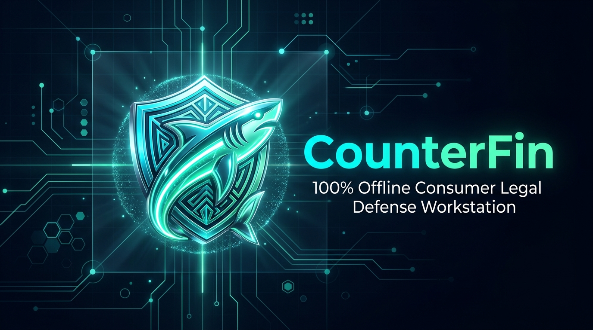

<p align="center">
  
</p>

<h1 align="center">CounterFin: Consumer Credit Shield & Dispute Console</h1>

<p align="center">
  <a href="https://boredpolymath.github.io/counterfin/"></a>
  <a href="https://github.com/boredpolymath/counterfin/actions/workflows/ci.yml"></a>
  <a href="LICENSE"></a>
  <a href="https://www.rust-lang.org/"></a>
  <a href="https://tauri.app/"></a>
  <a href="#privacy--security-by-design"></a>
  <a href="#getting-started"></a>
</p>

> **CounterFin** is a free, open-source, local-first desktop app that empowers consumers to defend against debt collectors. Whether dealing with credit card debt, hospital bills, auto loan deficiencies, or personal loans, CounterFin helps you organize notices, track statutory deadlines, catch illegal collection practices, and generate formal dispute letters—all without your data ever leaving your computer.
>
> 🌐 **Visit the official website:** [https://boredpolymath.github.io/counterfin/](https://boredpolymath.github.io/counterfin/)

---

## ⚖️ Legal Disclaimer

> **IMPORTANT NOTICE: SELF-ADVOCACY TOOL ONLY**  
> CounterFin is an informational, record-keeping, and procedural drafting utility designed for consumer self-advocacy under federal and state law (including the Fair Debt Collection Practices Act, 15 U.S.C. § 1692). **CounterFin is not a law firm, does not provide legal representation, and does not provide formal legal advice.**  
>
> Using this application does not create an attorney-client relationship. If you are facing an active lawsuit, a court summons, or require formal legal representation, please consult a licensed consumer rights attorney or legal aid organization in your jurisdiction.

---

## 📌 Table of Contents

- [What is CounterFin? (In Plain English)](#-what-is-counterfin-in-plain-english)
- [How It Works: 3 Simple Steps](#-how-it-works-3-simple-steps)
- [Key Features](#-key-features)
- [Debts Covered Under Federal Law (FDCPA)](#-debts-covered-under-federal-law-fdcpa)
- [Privacy & Security by Design](#-privacy--security-by-design)
- [For Developers & Contributors](#-for-developers--contributors)
  - [Tech Stack](#tech-stack)
  - [Prerequisites](#prerequisites)
  - [Quick Start Guide](#quick-start-guide)
  - [Project Directory Structure](#project-directory-structure)
  - [Testing & Quality Assurance](#testing--quality-assurance)
- [How to Contribute](#-how-to-contribute)
- [Community & Support](#-community--support)
- [License](#-license)

---

## 💡 What is CounterFin? (In Plain English)

Dealing with debt collection agencies can feel intimidating, confusing, and overwhelming. Collection agencies often rely on pressure tactics, incomplete documentation, and expired statutes of limitations.

**CounterFin levels the playing field.** It acts as your personal digital case manager:

1. **Keeps Everything in One Place:** Organize collection notices, creditor names, original account numbers, and alleged balances securely on your computer.
2. **Watches Your Deadlines:** Never miss the crucial **30-Day Debt Validation Window** under federal law.
3. **Flags Expired Debts:** Automatically checks whether a debt is past your state’s **Statute of Limitations (SOL)** so you don't accidentally revive a legally unenforceable debt.
4. **Catches Illegal Collector Behavior:** Keeps a timestamped log of phone calls, threats, and harassing behavior that violate the law.
5. **Drafts Professional Dispute Letters:** Generates customized, legally grounded dispute letters ready to print, sign, and mail via Certified Mail.

---

## 🚀 How It Works: 3 Simple Steps

```
┌─────────────────────────┐     ┌─────────────────────────┐     ┌─────────────────────────┐
│  1. Log Your Notice     │ ──> │  2. Spot Violations     │ ──> │  3. Send Your Dispute   │
│  Add creditor details,  │     │  App checks deadlines,  │     │  Preview, edit, and     │
│  dates & debt types.    │     │  SOL rules & illegal acts│    │  print customized letter│
└─────────────────────────┘     └─────────────────────────┘     └─────────────────────────┘
```

1. **Log Your Notice:** Enter details from the collector's letter or phone call (e.g., credit card balance, hospital bill, or car loan deficiency).
2. **Review Statutory Analysis:** CounterFin instantly calculates your 30-day response window, checks your state's statute of limitations, and audits whether the collector provided required chain-of-title proof.
3. **Generate & Send Dispute Letters:** Choose a tailored dispute template (Debt Validation, Time-Barred Cease & Desist, or Medical Coding Audit), customize it live in the preview editor, and print it out.

---

## ✨ Key Features

### 🗂️ Multi-Debt Case Dossiers
Organize disputes by debt type with custom color-coded indicators:
* **Credit Card Debt:** Audit junk debt buyers (Midland, Portfolio Recovery, LVNV) for missing chains of assignment, cardholder agreements, and itemized billing statements.
* **Medical Bills:** Request itemized billing with diagnostic and procedure codes (CPT/ICD-10) and check for out-of-network balance billing protections under the No Surprises Act.
* **Auto Loan Deficiencies:** Audit vehicle repossession sales for required UCC Article 9 auction accounting and gross proceeds calculations.
* **Personal & Installment Loans:** Demand proof of original promissory notes, lawful assignment, and state debt collector licensing.

### ⏱️ Statutory Deadline & 54-Jurisdiction SOL Engine
* **30-Day FDCPA Clock:** Countdown timer tracking your legal right to dispute debt and halt collection efforts under 15 U.S.C. § 1692g.
* **Statute of Limitations (SOL) Matrix:** Codified coverage across all **54 US jurisdictions** (all 50 states, District of Columbia, Puerto Rico, Guam, and US Virgin Islands) by debt classification.
* **Anti-Revival Protections:** Hardened alerts for states where partial payments or written acknowledgments cannot reset an expired statute of limitations (e.g., New York CPLR § 214-i Consumer Credit Fairness Act, Texas CPRC § 16.004 & Fin. Code § 392.307).
* **Agency Licensing & Surety Bond Registry:** Instant verification of collection agency licensing requirements and mandatory surety bond filings (e.g., Texas $10,000 bond requirement, California $25,000 bond, New Jersey $5,000 bond).

### 📜 Side-by-Side Letter Studio
* **Interactive Document Preview:** Real-time side-by-side editing pane with live Bates-stamping, legal citation checklists, and one-click print/PDF export.
* **Built-in Statutory Checklists:** Tailor demands with a single click (e.g., demand proof of original signature, accounting of interest and fees, or immediate cessation of phone calls).
* **Multi-Format Export Pipeline:** Export formal letters to Plaintext, Markdown, HTML, or directly to Bates-stamped document records.

### 📞 Interaction Stream & Violation Tracker
* **Communication Log:** Record incoming and outgoing calls, letters, and emails with collectors.
* **Automatic Violation Flagging:** Flags illegal actions under federal law (calls outside 8 AM–9 PM, workplace calls after notice, abusive language, or threatening legal action on time-barred debt).
* **Damages Calculator:** Keeps a running tally of potential statutory damages under 15 U.S.C. § 1692k (up to $1,000 per proceeding plus actual damages and legal fees).

### 🗄️ Tamper-Evident Evidence Vault
* **Cryptographic Hashing:** Ingest audio recordings, PDFs, scanned letters, and notices with automated SHA-256 checksums to establish evidentiary chain of custody.
* **OS-Level Directory Sandboxing:** Enforces sandbox containment within user-isolated application storage, preventing directory traversal vulnerabilities.

### 🖥️ Native Desktop System Tray Companion
* **Low-Footprint Daemon:** Ultra-efficient background monitoring daemon running at `< 25MB RSS`.
* **Sleep/Wake & Clock-Drift Compensation:** Tolerates system hibernation and clock shifts while continuously evaluating time-sensitive dispute windows.
* **Quick-Access Actions:** Instantly open the active disputes docket or record collector calls right from the system tray.

---

## 🏛️ Debts Covered Under Federal Law (FDCPA)

Under the Fair Debt Collection Practices Act (15 U.S.C. § 1692a(5)), federal consumer protections cover debts incurred primarily for personal, family, or household purposes:

| Debt Classification | Typical Creditors & Collectors | What CounterFin Audits & Demands |
|---|---|---|
| **💳 Credit Card Debt** | Banks, Junk Debt Buyers *(Midland, PRA, LVNV)* | Unbroken chain of title, charge-off billing history, Reg F itemization (12 CFR § 1006.34). |
| **🏥 Medical Debt** | Hospitals, Clinics, Medical Collection Agencies | Itemized CPT/ICD-10 codes, insurance adjustments, No Surprises Act compliance. |
| **🚗 Auto Deficiency** | Auto Lenders, Repossession Collection Firms | UCC Article 9 repossession accounting, notice of sale timeliness, auction reasonableness. |
| **📑 Personal Loans** | Fintech Lenders, Installment Loan Companies | Original signed promissory note, state collector licensing, and surety bond verification. |
| **⚡ Utility & Telecom** | Cell Carriers, Cable Providers, Utilities | Service contract validation, meter/usage billing history, credit bureau reporting marks. |

---

## 🔒 Privacy & Security by Design

Financial and medical records are deeply personal. CounterFin is engineered with a strict **local-first, zero-telemetry** architecture:

* **100% Local Storage:** All records, dispute notes, and evidentiary files are stored strictly on your local machine in an encrypted SQLite database.
* **Argon2id Key Derivation:** Master passphrases derive 256-bit keys using memory-hardened Argon2id (64MB memory cost, 3 iterations, 4 parallelism lanes).
* **ChaCha20-Poly1305 AEAD Encryption:** Authenticated encryption protects private records at rest and packages encrypted `.smbak` backup archives.
* **Cryptographic Memory Zeroization:** Sensitive credentials, SSNs, and decrypted keys implement `Zeroize` and `ZeroizeOnDrop`, scrubbing buffers from RAM immediately after use.
* **Crash-Resilient SQLite (WAL Mode):** Operates under Write-Ahead Logging (WAL) with integrity checkpointing, resisting sudden ungraceful process crashes and power loss.
* **Zero Telemetry & Zero Cloud:** No analytics trackers, no telemetry, no advertising pixels, no remote error-tracking services, and no user accounts.

---

## 🛠️ For Developers & Contributors

### Tech Stack

* **Core Runtime:** [Tauri v2.12](https://tauri.app/) (Lightweight, secure native desktop wrapper using system webviews).
* **Backend:** [Rust 1.90+ (2024 Edition)](https://www.rust-lang.org/) (High performance, memory safety, embedded SQLite WAL mode via `rusqlite 0.40`, Argon2id key derivation via `argon2 0.6`, ChaCha20-Poly1305 AEAD via `chacha20poly1305 0.11`, SHA-256 checksums via `sha2 0.11`, and memory zeroization via `zeroize 1.9`).
* **Frontend:** Clean Vanilla HTML5, Modern CSS (Design tokens, fluid grid, dark/light clinical themes), and ES6+ JavaScript. *No heavy node dependencies, no bundler lock-in, no Tailwind bloat.*

### Prerequisites

1. **Rust Toolchain:** Stable Rust (`rustc >= 1.90.0`, `cargo`). Install via [rustup.rs](https://rustup.rs/).
2. **Tauri CLI v2:**
   ```bash
   cargo install tauri-cli --version "^2.0"
   ```
3. **Platform Build Tools:**
   * **macOS:** Xcode Command Line Tools (`xcode-select --install`).
   * **Windows:** Visual Studio C++ Build Tools & Microsoft WebView2 Runtime.
   * **Linux:** `libwebkit2gtk-4.1-dev`, `build-essential`, `libssl-dev`, `libgtk-3-dev`, `libayatana-appindicator3-dev`.

### Quick Start Guide

```bash
# 1. Clone the repository
git clone https://github.com/boredpolymath/counterfin.git
cd counterfin

# 2. Verify backend compilation
cd src-tauri
cargo check

# 3. Launch the desktop app in development mode
cargo tauri dev
```

### Project Directory Structure

```text
counterfin/
├── assets/                     # Branding, screenshots, and visual assets
│   └── counterfin-banner.png   # Official CounterFin Credit Shield banner
│
├── src-tauri/                  # Native Rust Core & Desktop Engine
│   ├── Cargo.toml              # Rust crate dependencies
│   ├── tauri.conf.json         # Tauri window configuration, CSP & permissions
│   ├── src/
│   │   ├── main.rs             # Application entrypoint
│   │   ├── lib.rs              # Tauri IPC command registration
│   │   ├── crypto.rs           # Argon2id derivation, ChaCha20-Poly1305 AEAD, zeroization & .smbak
│   │   ├── db/                 # SQLite database schema, WAL mode, DAO queries & migrations
│   │   ├── models/             # Domain entities (DebtType, Case, Violation, Document, etc.)
│   │   ├── engine/             # Statutory rules, calculation engines & templates
│   │   │   ├── sol.rs          # 54-jurisdiction statute of limitations & anti-revival rules
│   │   │   ├── licensing.rs    # 54-jurisdiction debt collector licensing & surety bond registry
│   │   │   ├── vault.rs        # SHA-256 evidence vault, sandboxing & tamper detection
│   │   │   ├── medical.rs      # No Surprises Act & CPT/ICD-10 clinical coding audit engine
│   │   │   ├── ucc.rs          # UCC Article 9 auto repossession deficiency accounting
│   │   │   ├── fdcpa.rs        # FDCPA & CFPB Reg F statutory violation rules
│   │   │   ├── monitor.rs      # Temporal deadline tracking & sleep/wake drift tolerance
│   │   │   └── templates.rs    # 7 codified dispute letter templates & export pipeline
│   │   ├── commands/           # Frontend-to-Backend IPC handlers
│   │   └── tray/               # Lightweight desktop tray daemon (< 25MB RSS)
│   └── tests/                  # Exhaustive integration, chaos & security tests
│       ├── statutory_workflows.rs # E2E debt workflows (CRA, pay-for-delete, auto, medical)
│       ├── stress_and_chaos.rs    # SIGKILL crash recovery, WAL resilience & memory leak tests
│       ├── cross_platform_a11y.rs # Multi-OS sandbox resolution & tray menu verification
│       └── benchmarks.rs          # Sub-millisecond statutory query performance benchmarks
│
├── ui/                         # Clean Web Frontend (No Node build step needed)
│   ├── index.html              # Main dashboard, modals, and legal compliance views
│   ├── css/                    # Modular vanilla styling (tokens, layout, components)
│   └── js/                     # Application logic, mock fixtures, and view renderers
│       ├── app.js              # Event coordinator & UI controller
│       ├── ipc.js              # Tauri IPC bridge with offline fallback
│       └── views/              # View modules (Dashboard, Letter Studio, Stream, etc.)
│
├── markdown/                   # Comprehensive SDLC & compliance documentation
│   └── sdlc_checklist.md       # Master engineering & statutory signoff blueprint
├── CONTRIBUTING.md             # Contribution guidelines & coding conventions
├── CODE_OF_CONDUCT.md          # Contributor Covenant v2.1
├── LICENSE                     # MIT License
└── README.md                   # You are here!
```

### Testing & Quality Assurance

Ensure all tests and linters pass before opening a pull request:

```bash
# Run backend test suite
cargo test --all

# Run strict Clippy linter
cargo clippy --all-targets -- -D warnings

# Check code formatting
cargo fmt --all --check
```

---

## 🤝 How to Contribute

We love contributions! Whether you're an engineer, a consumer rights advocate, or a designer, there are many ways to get involved:

* **Add State SOL Rules:** Help expand our Statute of Limitations matrix for your state in `src-tauri/src/engine/sol.rs`.
* **Refine Dispute Templates:** Improve letter templates in `src-tauri/src/engine/templates.rs` to address emerging collection agency tactics.
* **Enhance the UI:** Improve accessibility, responsiveness, and keyboard shortcuts in the `ui/` directory.
* **Report Bugs & Suggest Features:** Use our [Issue Templates](.github/ISSUE_TEMPLATE/) to submit ideas or bug reports.

Please read our [Contributing Guide](CONTRIBUTING.md) and [Code of Conduct](CODE_OF_CONDUCT.md) before submitting a pull request.

---

## 💬 Community & Support

* **Issues & Discussions:** [GitHub Issues](https://github.com/boredpolymath/counterfin/issues)
* **Security Reports:** Please review [SECURITY.md](SECURITY.md) for responsible disclosure guidelines.
* **Maintainer:** Bored Polymath Studios

---

## 📄 License

This project is open-source software licensed under the **[MIT License](LICENSE)**.  
Copyright © 2026 Bored Polymath Studios.
